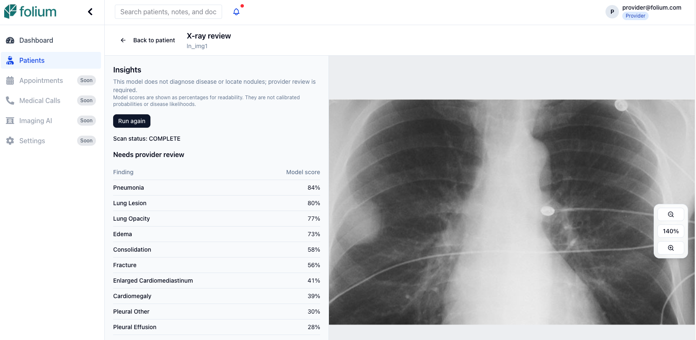

# X-ray second-look review

Folium's X-ray review integration is an experimental, self-hosted research
prototype. It runs a separately deployed classifier and surfaces asynchronous
results for provider review. It does not diagnose disease or detect/localize
nodules. Use only synthetic patient records and de-identified images during
local development.

## Start the real local service

1. Set a nonempty `XRAY_REVIEW_SERVICE_TOKEN` in the repository root `.env`. Keep
   the value private; the backend and imaging service must use the same token.
2. From the repository root, run `uv run folium`.
3. In the service picker, select **X-ray review (research only)** with Space. It
   is optional and unselected by default. Use `b` to build or `x` to recreate a
   service. If the token changed after backend startup, recreate **Backend API**
   too.
4. Press Enter to start the selected services. The runner explicitly starts the
   Compose-profile service when selected.
5. Wait for `folium-xray-review` to become healthy. First startup downloads and
   verifies the pinned model weights; later startups reuse the persistent model
   cache. Resolve download/startup/health failures before testing inference.

The model service is not required for ordinary local app startup. Its weights
are not committed to git.

## Test the real provider workflow

Do not set `NEXT_PUBLIC_API_MODE=mock`; the synthetic-demo banner must be absent.
Use a de-identified chest X-ray, not a regular photograph, to assess the image
workflow.

1. Open `http://localhost:3000` and sign in with a local provider account.
2. Open **Imaging AI** (or **Patients**), select **View History** for a synthetic
   patient, and find **Clinical Documents**. Imaging AI reuses the patient picker
   and existing image viewer rather than adding a second review workflow.
3. Select **Upload Document**. Choose a valid JPG or PNG under 10 MiB, set
   **Document Type** to **X-ray Image**, enter or keep the title, then select
   **Upload Document**.
4. After the upload succeeds, choose **Close** to dismiss the upload dialog.
5. In Clinical Documents, choose **View** on the image you just uploaded.
   Choose the small **X-ray review** button in the viewer toolbar. Folium
   navigates to a dedicated review page with insights on the left and the image
   on the right. Zoom controls float along the image's right edge. Zoom in to
   enable click-and-drag panning.
6. Confirm the research-only warning and choose **Run scan** in the insights pane.
7. Wait for a terminal **COMPLETE** or **FAILED** status. Polling may skip over
   PENDING or PROCESSING; do not assume a fixed completion time.
8. On COMPLETE, confirm the result shows **Needs provider review** and a table
   of findings with percentage-formatted model scores. The table omits `No
Finding`, orders the remaining labels from highest to lowest score, and does
   not display model provenance. Scores are not calibrated probabilities or
   disease likelihoods. Do not expect bounding boxes or nodule coordinates.
9. Choose **Back to patient**. Reopen **View → X-ray review** for the same
   document; confirm the saved result loads without running another scan.
   Confirm X-ray findings are shown in the review page, not the general
   Clinical Documents list.
10. Reload and reopen the same patient to confirm the saved results remain.
11. Test the document's **View** and **Download** actions separately. Confirm the
    JPG renders and the downloaded file opens. These checks are distinct from scan
    inference. If either fails, record the action, HTTP status, and sanitized
    browser error; never share signed URLs, credentials, or patient data.
12. Upload an image with another document type and confirm its viewer does not
    offer X-ray review. Upload a PDF; confirm **X-ray Image** is unavailable.

## Test failure and retry

Use only a synthetic local stack:

1. Stop the inference service:
   `docker compose --profile xray-review stop folium-xray-review`.
2. Upload a new valid image marked **X-ray Image**, open it from the document
   list, choose **X-ray review**, then choose **Run scan** in the insights pane.
   Confirm the scan reaches FAILED with an explicit error.
3. Restore the service:
   `docker compose --profile xray-review up -d folium-xray-review`.
   Wait until it is healthy.
4. Reopen **View → X-ray review** for the same image, choose **Retry scan**, and
   confirm the new attempt completes.
5. Also open a previously uploaded image and start/retry a scan from its viewer.
   Confirm it reaches FAILED while inference is stopped and succeeds after the
   service is restored.

Verify role restrictions and audit records through authorized local API checks;
a provider UI happy path alone does not establish access control. Do not close
the feature issue until real-stack acceptance checks pass.

## Known limitations

- The selected DenseNet-121 CheXpert model is research/education only, not for
  clinical use. Its `Lung Lesion` output is classification, not nodule detection
  or localization. Scores are not calibrated probabilities.
- The attachment viewing/download route now returns authorized file bytes from
  the backend instead of redirecting the browser to object storage. The frontend
  uses temporary blob URLs, avoiding browser CORS and Compose-only storage-host
  issues. Verify this path in the real local UI; an automated endpoint test does
  not establish end-to-end rendering in every browser.
- The model artifact is 28,298,128 bytes (about 28.3 MB / 27.0 MiB); dependencies,
  container size, and runtime memory are additional and unmeasured.
- Review results are persisted by the backend and loaded from the patient scan
  list when the image's X-ray review page opens. Mock-mode state is synthetic and
  browser-session-only.
- Scan jobs are persisted, but execution uses process-local FastAPI background
  tasks. Durable job processing/recovery is required before production.
