# Chart Review Agent Service

Dedicated Temporal and LangGraph worker for synthetic chart-review draft support.

The backend assembles a validated, traceable patient-context bundle and persists
terminal review states. This service runs the bounded agent workflow and returns
structured draft-support output. It does not make clinical decisions,
recommendations, or autonomous actions.

## Current Workflow

1. A clinician explicitly requests a draft from an interaction.
2. The backend validates the patient and interaction, persists a queued review,
   and starts a Temporal workflow with an immutable active-interaction snapshot.
3. The LangGraph worker first creates a bounded plan for one factual gap or
   chooses no search. A separate action decision selects up to three lexical
   terms for that fixed plan, then `retrieve_history` calls the backend as a
   Temporal Activity. An empty result may trigger another action for the same
   plan, up to three logical lookups; approved blocks stop retrieval. Each
   lookup can return at most three approved prior-interaction blocks. The
   worker has no database credentials, SQL access, document access, or
   unrestricted chart-search capability.
4. The `generate_review` node runs as a Temporal Activity. It sends the active
   snapshot and separately labelled prior context to the configured local
   OpenAI-compatible inference service.
5. The worker validates the provider response as `ChartReviewOutput`. Citations
   must exactly match supplied canonical source IDs, and confidence must be one
   of `low`, `medium`, or `high`.
6. The backend persists either the validated completed draft and citations or an
   explicit failed review. The clinician UI polls this persisted lifecycle and
   never displays partial model output.

```mermaid
flowchart LR
	 C[Clinician request] --> B[Backend snapshot and queued review]
	 B --> T[Temporal workflow]
	 T --> H[Plan Activity]
	 H --> A[Separate bounded action]
	 A --> R[History retrieval Activity]
	 R -->|No match, within budget| A
	 R --> G[LangGraph generation Activity]
	 G --> M[Local OpenAI-compatible model]
	 M --> V[Output and citation validation]
	 V --> P[Persist completed draft or failure]
```



## Boundaries

- Synthetic data only.
- The active interaction snapshot is immutable for a review request.
- The backend controls source selection and access policy.
- The worker validates canonical citations rather than inferring missing source
  blocks from an interaction ID.
- `missing_info` identifies gaps for clinician review. It does not trigger more
  retrieval or a follow-up action.

## Run

```bash
cd services/chartreview
uv run python -m app.worker
```

For the complete local stack, use the repository Compose configuration. The
worker requires the configured inference endpoint, backend URL, and internal
service token; it fails at startup when required configuration is missing.

## Responsibilities

- Register the chart-review graph through Temporal's `LangGraphPlugin`.
- Run the bounded history lookup and provider nodes as Temporal Activities.
- Validate structured output before returning it to the backend.
- Keep source references traceable to the input bundle.

## Matching Policy

The model selects only bounded lexical terms. The backend retains patient scope,
active-interaction exclusion, curated fields, and exact substring matching.
The loop does not enable synonyms, arbitrary regex, documents, or unrestricted
query syntax. Any normalized or token-aware backend matching policy requires
offline synthetic-benchmark comparison before production use.
